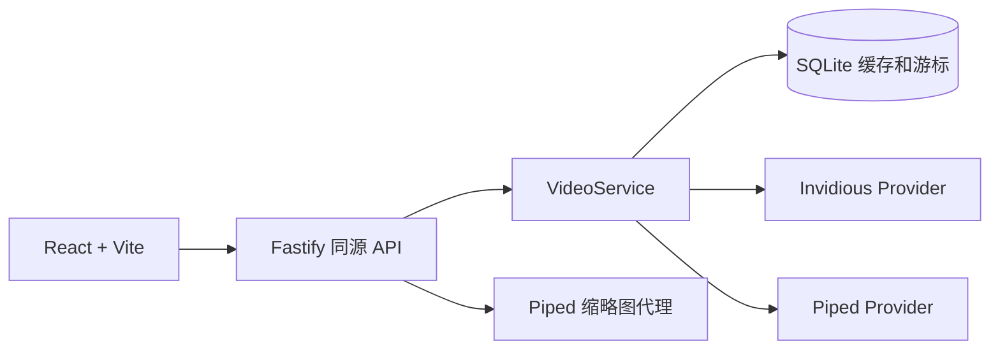

# 技术架构

`apps/web` 提供搜索、详情、分析和来源状态。客户端只请求本站 `/api`。外链仅在点击时打开 YouTube 原页。表格、分析和导出复用同一份筛选后的结果。应用内没有视频 iframe、媒体流和付费模型。界面中的缩略图经服务器转发。

`apps/api` 负责 HTTP 校验、SQLite 和各 Provider 适配。 `packages/shared` 提供统一 `Video`、`Channel`、`Comment`、`Track`、`Transcript` 和纯函数。共享的 `AnalysisProvider` 类型可接入以后授权的模型，当前分析为输入样本的计算结果。

## API

| 路径 | 行为 |
| --- | --- |
| `GET /api/search?q=&limit=&kind=` | 顺序取页、按 ID 去重，记录每页返回量和新 ID 数 |
| `GET /api/videos/:id` | 视频详情和字幕目录 |
| `GET /api/videos/:id/stats` | 视频点赞和评论总数，返回各字段的观测来源 |
| `GET /api/videos/:id/comments?order=&cursor=` | 热门／最新首屏，分页或回复对应的游标 |
| `GET /api/videos/:id/transcripts/:track` | 返回统一毫秒时间轴、逐段正文及全文 |
| `GET /api/thumbnail/:id` | 同源 TTL 缓存的缩略图 |
| `GET /api/status` | 当前进程的请求诊断与缓存计数 |
| `GET /api/health` | 本地健康检查 |

## Provider 和流控

实现 `apps/api/src/provider.ts` 中的 `Provider` 接口即可添加来源。在 `createApp` 注册新来源，声明评论排序和搜索类型能力，转成统一数据结构。每类请求使用既有 Provider 读取与回退逻辑，官方 Data API v3 可以在服务端引入单独的配额计数和凭据配置。

全部视频的搜索优先 Invidious。显式普通视频或 Shorts 过滤优先选择能返回类型标记的 Piped。首屏、详情和字幕有明确回退策略。搜索回退从备用来源第一页重启，跨来源合并 ID。评论续页游标只在创建它的来源、视频和排序下有效，避免混入一条来自其他排序或来源的线程。上游续页 token 存 SQLite，浏览器只持有短期不透明键。

每个元数据 origin 串行，完成到下次开始至少约 2 秒。超时 12 秒，网络或 5xx 最多再试一次，重试带退避。401、403、429 和 Retry-After 进入该 origin 冷却。两源都失败时返回结构化 503。搜索按页预算停止，浏览器可停止继续发出统计补齐请求。已经发出的请求会按上游超时或成功收尾。

SQLite 以原子写入保存带 TTL 的响应。搜索 20 分钟，部分结果 2 分钟，详情 30 分钟，评论及统计 10 分钟，字幕 12 小时。相同在途请求合并。缩略图用短期内存缓存并限制队列。缓存状态和实际采集时间随响应返回。请求日志保留来源、操作、结果和耗时，省略带签名地址、上游游标和评论正文。

默认是单进程本机 POC。若要多人公开使用，应给部署另加请求鉴权、跨进程配额、监控和持久化策略，并向实例运营者确认持续用量。
